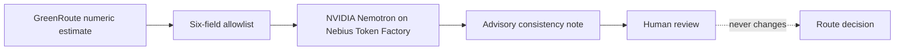

# GreenRoute Nemotron Audit Lab

Privacy-preserving numerical consistency review for GreenRoute using NVIDIA Nemotron on Nebius Token Factory.

The adapter sends only six allowlisted numerical estimates. It never sends the user’s free-text prompt, never changes a route decision, and always requires human review.

## Verified model

`nvidia/NVIDIA-Nemotron-3-Nano-30B-A3B` was verified in the live Token Factory catalogue on 27 October 2026 as an NVIDIA text-to-text model with a public endpoint. No dedicated deployment is required.

## Run the tests

```bash
python3 -m unittest discover -s . -v
```

## Make one live request

After confirming a positive credit balance and creating a Token Factory API key:

```bash
export NEBIUS_API_KEY='set-this-in-your-shell-only'
python3 run_live.py
```

Never commit the key. The saved receipt excludes credentials and the original user prompt.

## Data flow



## Status

Offline tests pass. The public repository is being completed. A real provider receipt and final video remain gated by Token Factory login and a verified account balance.

MIT licensed.
